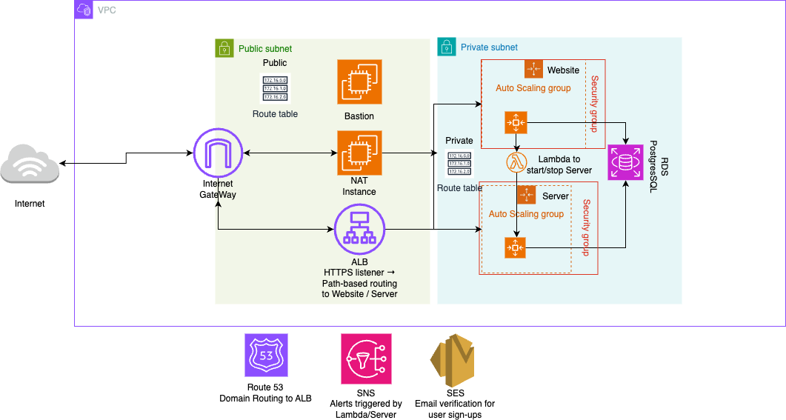

# Zero-Downtime Docker Deploy on AWS (Manual Workflow)

_A case study of how I kept **AI Prodigy** running at 99.9 % availability using nothing
but the AWS Console, the CLI, and well-crafted user-data scripts._

---

## Why this project matters 🚀
| Impact | Result |
|--------|--------|
| **High availability** | 99.9 % measured service uptime across two AZs |
| **Zero-downtime releases** | Rolling updates—new instances pass health checks before traffic shifts |
| **Cost optimisation** | ~ 40 % lower monthly networking spend by swapping a NAT Gateway for a NAT `t3.micro` + VPC interface endpoints |
| **Security** | All secrets pulled at boot from AWS Secrets Manager; TLS everywhere via ACM |
| **Hands-on skills** | EC2 Auto Scaling, ALB path routing, Docker, ECR, Bash cloud-init, CloudWatch Alarms |

*(Full run-book—with exact commands, IAM JSON and user-data—is kept private)*

---

## At-a-Glance Architecture



---

## How the rollout works ⬇️

1. **Build & push**
   ```bash
   docker build -t ap-api:<git-sha> backend/
   docker push <acct>.dkr.ecr.<region>.amazonaws.com/ap-api:<git-sha>
   ```
2. **Create a new Launch Template version**
   - Same hardened Amazon Linux 2 AMI
   - User-data pulls the `<git-sha>` image from ECR and starts the container.
3. **Point the Auto Scaling Group at the new version and start an instance refresh**
   - Minimum healthy 100 %, maximum healthy 200 % (launch before terminate).
   - A new instance boots and passes ALB health checks, then an old one is drained and terminated.
4. **Observe** with CloudWatch Alarms (`HTTPCode_Target_5XX_Count`) and Slack notifications.
5. **Roll back** by pointing the ASG at the previous Launch Template version and refreshing again.

No SSH into production boxes; every change is reproducible.

## Key AWS Services Used
- EC2 Auto Scaling – capacity spread across us-east-2a/b
- Application Load Balancer – HTTPS, path-based routing
- ECR – private Docker registry
- Secrets Manager – DB creds & JWT secret pulled at boot
- CloudWatch – logs, metrics, alarms → SNS
- ACM – TLS certificates

## Results & Lessons

- Reduced release lead-time 5× versus manual `ssh && docker pull`.
- Cut networking cost ≈ 40 % by replacing the managed NAT Gateway.
- Proved that even without fancy CI/CD you can achieve continuous delivery principles with built-in AWS primitives.

## What Came Next

- **Jun 2025:** moved this flow to GitHub Actions → ECR → AWS CodeDeploy blue/green.
- **Oct 2025:** migrated the website to ECS Fargate with all infrastructure in Terraform.
- **Mar 2026:** moved the website to a serverless Terraform stack (CloudFront, API Gateway, Lambda).

See [infrastructure-docs](https://github.com/jdgermosen/infrastructure-docs) for the architecture timeline.

## Tech Stack

AWS (EC2·ALB·ASG·ECR·Secrets Manager) · Docker · Bash · CloudWatch · Route 53 · TLS/ACM · PostgreSQL
